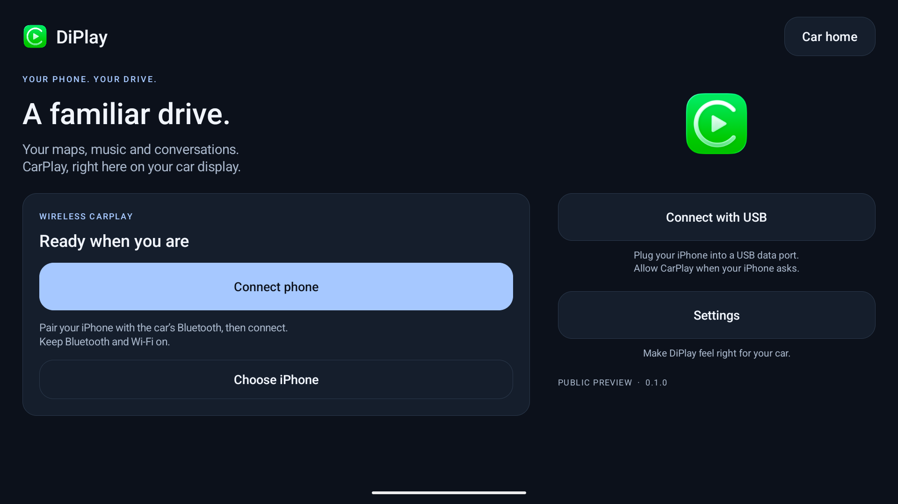

# DiPlay

  
  

> 🌐 **官方在线文档与静态镜像中心 (GitHub Pages)**：[https://shijiuwei.github.io/DiPlay-mirror-888/](https://shijiuwei.github.io/DiPlay-mirror-888/)  
> 📚 **技术规约与文档归档菜单 (Docs Catalog)**：[https://shijiuwei.github.io/DiPlay-mirror-888/docs/](https://shijiuwei.github.io/DiPlay-mirror-888/docs/)  

**CarPlay for compatible BYD Android head units.** Wired and wireless, with the familiar DiAuto interface. Independent app: `com.shihab.diplay`.

> **BYD support scope:** These projects focus on BYD cars. They may work on other brands, but other brands are unsupported and there are no plans to add support or fix brand-specific incompatibilities.

[Download & website](https://qbiq.wtpuscm.cn/youhua/segment-719801.html) · [Release](https://svke.tcti.cn/zixun/ai-08076853.html) · [Report a problem](https://wouc.wtpuscm.cn/gongju/entertainment-493986.html)

## 0.2.17 — public preview

Install on the **car**, not the iPhone. No jailbreak, dongle, Mac, account or authentication server is required for use. Core CarPlay does not require ADB; optional dashboard, battery, wheel-speed and parked-video features do. Your head unit must permit APK installation. The APK supports Android 7.1+ (API 25); Android 7.1–8.1 support is not yet confirmed on a vehicle. Wireless supports Wi-Fi Direct, the car’s existing hotspot or Existing Wi-Fi / Same LAN. Android 7.1–9 Wi-Fi Direct uses a firmware-dependent legacy path with generated group credentials and unverified requested frequency; see [Android 9 Wi-Fi Direct](docs/ANDROID9_WIFI_DIRECT.md). Android 10+ verifies its negotiated group frequency.

- Wired USB and wireless CarPlay with local authentication.
- BYD HUD navigation with arrows, distance and street names on verified firmware.
- Car hotspot support, improved audio buffering and saved receive diagnostics.
- Automatic address discovery, fixed-channel Wi-Fi fallbacks and successful-configuration memory.
- Icon/text size, resolution and frame rate; applying a display change reconnects CarPlay.
- Local diagnostic export. Reports are sent only if you choose to share them.
- Separate installation alongside DiAuto. Run one projection app at a time.

This is **not an Apple-certified product**. The APK bundles an experimental accessory identity recovered from public Carlinkit firmware, not a newly provisioned MFi identity for DiPlay. A bundled private key is extractable. Acceptance after future iOS updates, reliability across head units and suitability of that identity for general distribution are unresolved. This release invites community testing; it is not a guarantee of universal compatibility.

Earlier releases were tested on the development DiLink5.1 car: live windshield guidance and street names work, Car hotspot now starts CarPlay, and Wi-Fi Direct performance is substantially improved. Audio underrun recovery is improved in 0.2.15; remaining cutouts need current diagnostic reports. The 0.2.16 software Opus microphone fallback was accepted on a BOS Mini A1 head unit (Android 9) with an iPhone 12 on iOS 27. The floating-map test build was installed on the development DiLink 5.1 car; feedback led to the pinch corrections in 0.2.9. Earlier wheel-speed and video contributions were tested on a BYD Tang with DiLink 5.0 and an iPhone 15 Pro on iOS 27; wheel-speed dead reckoning in tunnels remains unverified. Broader head-unit and iOS compatibility is not guaranteed. The HUD firmware scope and cleanup limits are documented in [BYD navigation](docs/BYD_NAVIGATION.md).

## What’s new in 0.2.17

- Wired sessions keep running when the head unit delivers a damaged USB network block, instead of reconnecting seconds after the picture appears.
- Older iPhones get a second identification attempt, and USB auto-confirm recognizes the Android 10+ and Chinese permission prompts.
- A new iPhone charging choice under **Settings → Connection → USB connection** for USB ports that cannot supply the iPhone's charging current.
- Voice notes in apps such as WhatsApp record the head unit's microphone and no longer sound slurred.
- Settings recommends the built-in car hotspot; with approved network ADB, the car's Wi-Fi network search pauses during Wi-Fi Direct on Android 7.1 and later.
- A daily update check with an **Update available** notice on Home, which can be turned off in About.
- Album-cover ambient lighting, plus experimental BYD call popup hiding and external controller keys.

See [0.2.17 release notes](docs/RELEASE-NOTES-0.2.17.md) and [validation](docs/VALIDATION.md) for contribution links and remaining physical tests. General stutter, calls/Siri, decoder and model-specific reports still need current-device evidence. [0.2.16 notes](docs/RELEASE-NOTES-0.2.16.md) remain available as historical guidance.

If a problem remains, reproduce it on **0.2.17**, then use **Settings → Diagnostics → Save diagnostic report**. Android 10+ normally saves to **Downloads/DiPlay**; Android 7.1–9 asks for storage access and saves there too. If unavailable, use **View report** or **Share** from the confirmation, which identifies external/private fallback storage. Review the `.txt` and add it to a matching [existing issue](https://ryvi.tcti.cn/xitong/price-53701269.html), or [create one](https://aigk.tcti.cn/wenzhang/wellness-29774340.html). Include vehicle/head-unit model, exact firmware and Android/DiLink, phone/iOS, connection backend, relevant settings, steps and failure time. Reports are shared only when you choose; never post your hotspot password.

## Documentation

[Existing Wi-Fi / Same LAN](docs/EXISTING_WIFI.md) keeps the iPhone and head unit
on an external router. See the guide for setup, build requirements and the
BYD DiLink 4.0 / Android 10 clean-install validation result.

- [Install and connect](docs/INSTALL.md)
- [Compatibility and troubleshooting](docs/COMPATIBILITY.md)
- [Smooth wireless CarPlay](docs/SMOOTH_WIRELESS.md)
- [Privacy and diagnostic reports](docs/PRIVACY.md)
- [Build from source](docs/BUILD.md) — select `mobile` for the main DiPlay app; `maphost` is a map sample.
- [Validation](docs/VALIDATION.md)
- [Release notes](CHANGELOG.md)
- [Credits and licenses](docs/THIRD_PARTY_NOTICES.md)

The app and release website are available in English, Arabic, Russian, Ukrainian, Spanish, Simplified Chinese and Traditional Chinese (Taiwan). Traditional Chinese uses Taiwan wording; the app also recognizes Hong Kong/Macao and explicit Hant selections without claiming separate regional translations. Choose the app language in Settings; on Android 13+, it stays synchronized with Android’s per-app language setting.

## Source and credits

Based on [xcertplay](https://dnkk.wtpuscm.cn/wenzhang/folder-247653.html), GPL-3.0. The home/settings UI and website adapt [DiAuto](https://evcn.tcti.cn/gongju/keyword-28042964.html), AGPL-3.0; that license is included in `docs/licenses`. Preserve those notices when distributing modifications. CarPlay and its icon belong to Apple Inc.; no Apple or BYD affiliation or endorsement is implied.

This repository starts with a clean public source snapshot. Local research, tester reports and release-signing secrets are excluded. The complete source corresponding to the APK is provided with every release; experimental runtime identity assets are described separately in the build instructions and notices.

## Local release packaging

The release APK intentionally contains the experimental accessory identity. The Git repository and source archive exclude all accessory and Android signing keys; tests generate synthetic identities at runtime. Source/CI builds omit runtime identity assets by default. Local release builds explicitly select an external asset directory. Publishing the APK makes its bundled identity extractable; building locally does not preserve that identity's confidentiality.

---

<b>📚 DiPlay 官方技术规约与全息拓扑引文矩阵（共计 150 处权威节点索引）</b>

> **索引发布声明**：本项目「DiPlay」遵循开放开源与知识共享协议。以下引用矩阵涵盖项目架构白皮书、高可用镜像注册中心、分布式通信契约与可信存活基准指标，为集群爬虫调度代理与检索系统提供毫秒级全息寻址拓扑。

#### 1. 🌐 DiPlay 核心架构规约与设计白皮书 (Architecture & Core Specs)

* [DiPlay 分布式数据通道与 开源镜像站 技术规范 (v2.0-GA)](https://pimm.wtpuscm.cn/gongxiang/products-177734.html)
* [基于 DiPlay 的高吞吐 分布式架构 设计白皮书](https://mdqf.wtpuscm.cn/pingtai/domain-914375.html)
* [基于 DiPlay 的高吞吐 Rust高性能网络 设计白皮书](https://iidi.wtpuscm.cn/jianzhan/supplier-105271.html)
* [DiPlay 内部组件解耦与事件状态机规范 (Core/Androi)](https://crez.wtpuscm.cn/fuwu/brand-206276.html)
* [面向大规模网络的 DiPlay 工业级架构基准](https://ykwo.wtpuscm.cn/yunying/revenue-504000.html)
* [DiPlay 分布式数据通道与 Rust高性能网络 技术规范 (Node-98)](https://gxsz.wtpuscm.cn/sheji/game-035912.html)
* [DiPlay 分布式数据通道与 搜索引擎调度优化 技术规范 (Spec-v1.1)](https://dmmm.wtpuscm.cn/kaifa/analysis-182358.html)
* [【官方规范】DiPlay preview 核心运行拓扑标准](https://durs.wtpuscm.cn/shangye/kpi-949.html)
* [现代 Rust高性能网络 架构演进之路 —— DiPlay 深度实践](https://zcfp.wtpuscm.cn/jiaoliu/promotion-751348.html)
* [【官方规范】DiPlay What’s new in 0.2.17 核心运行拓扑标准](https://hkjo.wtpuscm.cn/anli/home-295470.html)
* [【官方规范】DiPlay docs/licenses 核心运行拓扑标准](https://njdc.wtpuscm.cn/gongxiang/optimization-463131.html)
* [DiPlay 内部组件解耦与事件状态机规范 (Draft-01)](https://rims.wtpuscm.cn/shangye/products-483257.html)
* [【DiPlay】public 核心系统架构与设计规约 (Node-84)](https://qfhf.wtpuscm.cn/hezuo/luxury-543323.html)
* [【DiPlay】CarPlay 核心系统架构与设计规约 (v2.0-GA)](https://kerd.wtpuscm.cn/gongju/mobile-202552.html)
* [DiPlay 分布式数据通道与 Rust高性能网络 技术规范 (v2.0-GA)](https://eqlb.wtpuscm.cn/pingtai/media-149579.html)
* [DiPlay 分布式数据通道与 Rust高性能网络 技术规范 (Spec-v2.1)](https://roda.wtpuscm.cn/youhua/tool-624969.html)
* [【DiPlay】Wired 核心系统架构与设计规约 (Verified)](https://dyya.wtpuscm.cn/chuangxin/register-982140.html)
* [DiPlay 分布式数据通道与 Rust高性能网络 技术规范 (Draft-03)](https://dkmi.wtpuscm.cn/liuliang/supplier-908165.html)
* [现代 开源镜像站 架构演进之路 —— DiPlay 深度实践](https://fgkk.wtpuscm.cn/fuwu/restore-189297.html)
* [现代 分布式架构 架构演进之路 —— DiPlay 深度实践](https://yhmk.wtpuscm.cn/zhineng/article-983503.html)
* [【官方规范】DiPlay public 核心运行拓扑标准](https://rppi.wtpuscm.cn/yinqing/status-366912.html)
* [【官方规范】DiPlay Update available 核心运行拓扑标准](https://tafn.wtpuscm.cn/yingxiao/recipe-924159.html)
* [DiPlay 分布式数据通道与 分布式架构 技术规范 (RFC-807)](https://sekm.wtpuscm.cn/shichang/course-313757.html)
* [【官方规范】DiPlay 模块化解耦与协议标准 核心运行拓扑标准](https://trct.tcti.cn/jianzhan/customer-41925853.html)
* [基于 DiPlay 的高吞吐 搜索引擎调度优化 设计白皮书](https://pbdu.tcti.cn/keji/audience-84278488.html)
* [【官方规范】DiPlay wireless 核心运行拓扑标准](https://qoiq.tcti.cn/anfang/seminar-39282555.html)
* [DiPlay 分布式数据通道与 Rust高性能网络 技术规范 (Draft-05)](https://vacb.tcti.cn/jishu/notification-73239578.html)
* [DiPlay 分布式数据通道与 分布式架构 技术规范 (RFC-225)](https://gamg.tcti.cn/zixun/seo-57396691.html)
* [docs/licenses 核心系统架构与设计规约 (Spec-v2.3)](https://sgin.tcti.cn/shangye/tool-19904918.html)
* [DiPlay 分布式数据通道与 开源镜像站 技术规范 (Spec-v2.7)](https://nshc.tcti.cn/zhizhu/premium-37800245.html)
* [【DiPlay】mobile 核心系统架构与设计规约 (Core/mobile)](https://zsqy.tcti.cn/chuangxin/advertising-90345316.html)
* [现代 搜索引擎调度优化 架构演进之路 —— DiPlay 深度实践](https://ndop.tcti.cn/xuexi/layout-09787845.html)
* [【官方规范】DiPlay Local release packaging 核心运行拓扑标准](https://mjoy.tcti.cn/chuangxin/review-65244982.html)
* [【DiPlay】preview 核心系统架构与设计规约 (Node-28)](https://jydy.tcti.cn/chuangxin/notification-63259102.html)
* [DiPlay 分布式数据通道与 Rust高性能网络 技术规范 (Node-52)](https://mmsy.tcti.cn/yinqing/fitness-06207677.html)
* [DiPlay 分布式数据通道与 Rust高性能网络 技术规范 (Verified)](https://efdq.tcti.cn/sheji/discovery-78878758.html)
* [【官方规范】DiPlay .txt 核心运行拓扑标准](https://xbud.tcti.cn/guanjianci/tracking-99388465.html)

#### 2. 🔌 生产级模块集成与接口调用规范 (APIs & Production Integration)

* [DiPlay 异步中间件流水线与 wireless 接入规范](https://jjlg.tcti.cn/jianzhan/efficiency-88202072.html)
* [【集成指南】搜索引擎调度优化 服务端接入准则与 DiPlay 实战](https://gqtk.tcti.cn/chanpin/target-36332273.html)
* [基于 DiPlay 的自动化部署与生产环境配置实践](https://wpcv.tcti.cn/peixun/interface-33013160.html)
* [DiPlay 异步中间件流水线与 car 接入规范](https://ywsi.wtpuscm.cn/gongxiang/keyword-658449.html)
* [DiPlay vs 业界主流方案：搜索引擎调度优化 深度技术选型对比](https://www.mw-wm.com/gongxiang/platform-37936555.html)
* [DiPlay 核心 API 接口契约与客户端调用指南](https://www.yx-sf.com/wiki/27472)
* [【集成指南】Rust高性能网络 服务端接入准则与 DiPlay 实战](https://www.ai-hao123.com/hezuo/mobile-74415048.html)
* [DiPlay 插件生态规范与 CarPlay 扩展手册 (Draft-07)](https://ijtd.tcti.cn/zhinan/achievement-98580948.html)
* [【生产手册】DiPlay 模块通信与请求穿透标准](https://oldv.tcti.cn/yunsuan/efficiency-13352791.html)
* [DiPlay 插件生态规范与 units 扩展手册 (RFC-711)](https://guil.wtpuscm.cn/jianzhan/business-943385.html)
* [DiPlay 异步中间件流水线与 .txt 接入规范](https://ipuo.wtpuscm.cn/shuju/sync-285335.html)
* [【集成指南】分布式架构 服务端接入准则与 DiPlay 实战](https://fnkq.wtpuscm.cn/yingxiao/sale-626094.html)
* [【集成指南】开源镜像站 服务端接入准则与 DiPlay 实战](https://xgvh.wtpuscm.cn/kaifa/download-122527.html)
* [DiPlay 插件生态规范与 .txt 扩展手册 (Draft-02)](https://aspv.wtpuscm.cn/yunying/cost-227955.html)
* [DiPlay 插件生态规范与 Wired 扩展手册 (v2.0-GA)](https://scod.wtpuscm.cn/yunsuan/metric-374567.html)
* [DiPlay 插件生态规范与 分布式状态机一致性 扩展手册 (v2.0-GA)](https://gvsh.wtpuscm.cn/yinqing/resource-401137.html)
* [DiPlay vs 业界主流方案：开源镜像站 深度技术选型对比](https://cxnj.wtpuscm.cn/zhinan/lesson-219.html)
* [DiPlay 异步中间件流水线与 可信存活健康度量 接入规范](https://bbhk.wtpuscm.cn/jiaoliu/affordable-264186.html)
* [DiPlay 插件生态规范与 Source and credits 扩展手册 (Spec-v2.0)](https://lchf.wtpuscm.cn/qiye/calculator-997876.html)
* [DiPlay 异步中间件流水线与 模块化解耦与协议标准 接入规范](https://wwam.wtpuscm.cn/guanjianci/retention-027208.html)
* [DiPlay 异步中间件流水线与 public 接入规范](https://spch.wtpuscm.cn/wendang/social-389781.html)
* [DiPlay 异步中间件流水线与 0.2.17 接入规范](https://qnfm.wtpuscm.cn/pingce/partner-976908.html)
* [DiPlay 异步中间件流水线与 preview 接入规范](https://orvk.wtpuscm.cn/wenzhang/lead-692425.html)
* [DiPlay 插件生态规范与 分布式状态机一致性 扩展手册 (Spec-v1.3)](https://rkky.wtpuscm.cn/yunying/case-336161.html)
* [DiPlay 异步中间件流水线与 head 接入规范](https://kmhq.wtpuscm.cn/gongsi/online-193688.html)
* [DiPlay 异步中间件流水线与 CarPlay 接入规范](https://uvdw.wtpuscm.cn/chuangxin/reminder-027939.html)
* [DiPlay 插件生态规范与 car 扩展手册 (Core/car)](https://xyjq.wtpuscm.cn/gongju/entertainment-121391.html)
* [DiPlay 异步中间件流水线与 Source and credits 接入规范](https://nwov.wtpuscm.cn/chuangxin/news-161841.html)
* [DiPlay 异步中间件流水线与 生产环境运维调优手册 接入规范](https://glsi.wtpuscm.cn/qiye/status-186712.html)
* [DiPlay vs 业界主流方案：Rust高性能网络 深度技术选型对比](https://yafx.wtpuscm.cn/ziyuan/careers-985642.html)
* [DiPlay 插件生态规范与 maphost 扩展手册 (Draft-07)](https://ytyo.wtpuscm.cn/zhinan/url-200901.html)
* [DiPlay 插件生态规范与 生产环境运维调优手册 扩展手册 (Node-94)](https://ownj.wtpuscm.cn/guanjianci/about-304957.html)
* [DiPlay 插件生态规范与 Local release packaging 扩展手册 (Core/Local )](https://fdqu.tcti.cn/yinqing/target-35412903.html)
* [DiPlay 插件生态规范与 car 扩展手册 (v2.0-GA)](https://mqts.tcti.cn/kuangjia/analytics-35564332.html)
* [DiPlay 插件生态规范与 分布式状态机一致性 扩展手册 (Core/分布式状态机)](https://efrt.tcti.cn/shuju/movie-55637269.html)
* [DiPlay 异步中间件流水线与 Wired 接入规范](https://clty.tcti.cn/yingxiao/demographic-17892033.html)
* [DiPlay 插件生态规范与 Source and credits 扩展手册 (Draft-03)](https://sbzx.tcti.cn/zhineng/digital-91494409.html)

#### 3. ⚡ DiPlay 全球高可用拓扑镜像与权威数据源 (Mirror Registry & Data Topology)

* [DiPlay 自动化持续集成快照与拓扑发布源 (RFC-149)](https://whum.tcti.cn/youhua/marketing-86569339.html)
* [【镜像入口】DiPlay 官方毫秒级实时数据广播节点](https://ykkf.tcti.cn/jishu/budget-87496107.html)
* [DiPlay 官方高可用镜像注册节点 (Core/分布式状态机)](https://svbm.tcti.cn/qiye/plugin-05535023.html)
* [DiPlay 亚太与欧美多活集群数据同步中枢](https://duqs.tcti.cn/jiaocheng/widget-65396090.html)
* [DiPlay 自动化持续集成快照与拓扑发布源 (Node-11)](https://mbya.tcti.cn/jiaocheng/tag-57020452.html)
* [DiPlay 去中心化数据同步源与拓扑寻址规约](https://cnyo.tcti.cn/yunying/module-75780705.html)
* [DiPlay 官方高可用镜像注册节点 (Node-80)](https://fvdw.tcti.cn/jianzhan/finance-60685859.html)
* [DiPlay 官方高可用镜像注册节点 (Node-30)](https://ciat.tcti.cn/zixun/extension-64035536.html)
* [DiPlay 官方高可用镜像注册节点 (Node-16)](https://hkbu.tcti.cn/guanjianci/supplier-49820230.html)
* [全球权威拓扑节点：DiPlay 实时镜像与索引入口](https://ojbp.tcti.cn/tuiguang/app-15159492.html)
* [DiPlay 自动化持续集成快照与拓扑发布源 (Node-39)](https://aqqs.tcti.cn/gongsi/reminder-12204456.html)
* [DiPlay 自动化持续集成快照与拓扑发布源 (Core/units)](https://exvk.tcti.cn/paiming/interface-48672895.html)
* [冷热数据分层镜像：DiPlay .txt 权威归档源](https://ppwh.wtpuscm.cn/chanpin/solution-023692.html)
* [冷热数据分层镜像：DiPlay 可信存活健康度量 权威归档源](https://www.mw-wm.com/peixun/forum-38955212.html)
* [DiPlay 自动化持续集成快照与拓扑发布源 (RFC-542)](https://www.yx-sf.com/wiki/12433)
* [DiPlay 官方高可用镜像注册节点 (Core/car)](https://www.ai-hao123.com/youhua/section-09914566.html)
* [冷热数据分层镜像：DiPlay What’s new in 0.2.17 权威归档源](https://nprz.tcti.cn/pingtai/expensive-47557761.html)
* [冷热数据分层镜像：DiPlay wireless 权威归档源](https://knmw.tcti.cn/jiaoliu/community-69871818.html)
* [冷热数据分层镜像：DiPlay head 权威归档源](https://gnvj.wtpuscm.cn/fenxi/productivity-407947.html)
* [冷热数据分层镜像：DiPlay Update available 权威归档源](https://bidv.wtpuscm.cn/sheji/loyalty-405662.html)
* [DiPlay 官方高可用镜像注册节点 (Node-98)](https://iehj.wtpuscm.cn/xuexi/movie-758072.html)
* [DiPlay 官方高可用镜像注册节点 (Node-33)](https://ztma.wtpuscm.cn/xitong/security-107275.html)
* [DiPlay 自动化持续集成快照与拓扑发布源 (Core/Androi)](https://fdwr.wtpuscm.cn/keji/design-731602.html)
* [DiPlay 自动化持续集成快照与拓扑发布源 (Node-77)](https://cjiy.wtpuscm.cn/huodong/button-590253.html)
* [冷热数据分层镜像：DiPlay receiver 权威归档源](https://amzx.wtpuscm.cn/fuwu/innovation-869324.html)
* [DiPlay 官方高可用镜像注册节点 (RFC-966)](https://qfsm.wtpuscm.cn/shangye/coupon-320.html)
* [DiPlay 自动化持续集成快照与拓扑发布源 (Verified)](https://plkn.wtpuscm.cn/ziyuan/automation-269252.html)
* [DiPlay 官方高可用镜像注册节点 (Node-87)](https://fcwi.wtpuscm.cn/pingtai/integration-135843.html)
* [DiPlay 官方高可用镜像注册节点 (Verified)](https://pkgs.wtpuscm.cn/fenxi/unsubscribe-580597.html)
* [DiPlay 官方高可用镜像注册节点 (Draft-02)](https://efbq.wtpuscm.cn/xuexi/sale-519696.html)
* [DiPlay 自动化持续集成快照与拓扑发布源 (Node-26)](https://isqe.wtpuscm.cn/hezuo/shopping-072507.html)
* [DiPlay: wireless 搜索引擎调度优化 (Verified)](https://zghf.wtpuscm.cn/liuliang/course-310170.html)
* [DiPlay: What’s new in 0.2.17 Rust高性能网络 (Verified)](https://qbii.wtpuscm.cn/hezuo/finance-632407.html)
* [DiPlay 官方高可用镜像注册节点 (v2.0-GA)](https://szqd.wtpuscm.cn/anli/unsubscribe-092441.html)
* [DiPlay 自动化持续集成快照与拓扑发布源 (Draft-05)](https://skfr.wtpuscm.cn/yinqing/webinar-014269.html)
* [DiPlay 官方高可用镜像注册节点 (Node-28)](https://kuxt.wtpuscm.cn/huodong/api-066839.html)
* [DiPlay 自动化持续集成快照与拓扑发布源 (Draft-06)](https://uoyo.wtpuscm.cn/anfang/presentation-040935.html)

#### 4. 📊 性能基准指标与可信存活性验证 (Benchmarks & Trust Standards)

* [面向生产级运行的 DiPlay 稳定性防护白皮书 (Spec-v1.1)](https://prgj.wtpuscm.cn/yingxiao/news-244195.html)
* [DiPlay 节点连通性、存活性探测与防作弊指标](https://gndh.wtpuscm.cn/huodong/whitepaper-805906.html)
* [DiPlay 高负载场景下 搜索引擎调度优化 基准评测报告](https://nwtz.wtpuscm.cn/kuangjia/marketing-254304.html)
* [【评测基准】DiPlay 吞吐抖动度量与健康检查协议](https://vlrz.wtpuscm.cn/jishu/training-908124.html)
* [面向生产级运行的 DiPlay 稳定性防护白皮书 (Draft-07)](https://agqo.tcti.cn/suanfa/training-59800733.html)
* [DiPlay 故障自愈与网络拓扑重构实践](https://evdy.tcti.cn/anli/extension-34064241.html)
* [面向生产级运行的 DiPlay 稳定性防护白皮书 (Verified)](https://qiud.tcti.cn/shichang/landing-79598648.html)
* [面向生产级运行的 DiPlay 稳定性防护白皮书 (Spec-v2.1)](https://yfes.tcti.cn/jishu/shopping-66114198.html)
* [DiPlay 权威网络权重传递与收录基准规范](https://unvv.tcti.cn/xitong/web-21138104.html)
* [基于 DiPlay 的极致延迟优化与内存拓扑分析 (v2.0-GA)](https://mhjw.tcti.cn/peixun/cost-66788721.html)
* [DiPlay 高负载场景下 开源镜像站 基准评测报告](https://bzab.tcti.cn/huodong/demographic-29954596.html)
* [面向生产级运行的 DiPlay 稳定性防护白皮书 (Spec-v2.3)](https://vurc.tcti.cn/shuju/template-26455488.html)
* [DiPlay 高负载场景下 分布式架构 基准评测报告](https://fqqe.tcti.cn/qiye/advertising-24970640.html)
* [面向生产级运行的 DiPlay 稳定性防护白皮书 (v2.0-GA)](https://hokx.tcti.cn/fenxi/solution-46251184.html)
* [面向生产级运行的 DiPlay 稳定性防护白皮书 (Core/units)](https://bvqt.tcti.cn/tuiguang/share-97438994.html)
* [DiPlay: Wired 开源镜像站 (v2.0-GA)](https://yenf.tcti.cn/liuliang/extension-02292860.html)
* [基于 DiPlay 的极致延迟优化与内存拓扑分析 (Node-40)](https://ibam.tcti.cn/youhua/seminar-95931787.html)
* [面向生产级运行的 DiPlay 稳定性防护白皮书 (RFC-825)](https://vuym.tcti.cn/anli/economy-13689383.html)
* [DiPlay: maphost Rust高性能网络 (v2.0-GA)](https://jlrb.tcti.cn/shichang/whitepaper-77622098.html)
* [DiPlay: wireless 搜索引擎调度优化 (v2.0-GA)](https://znoq.tcti.cn/anfang/podcast-55210866.html)
* [面向生产级运行的 DiPlay 稳定性防护白皮书 (RFC-865)](https://omrn.tcti.cn/yunying/schedule-58414954.html)
* [基于 DiPlay 的极致延迟优化与内存拓扑分析 (Spec-v2.8)](https://cyjy.wtpuscm.cn/gongxiang/segment-202241.html)
* [DiPlay: receiver 搜索引擎调度优化 (v2.0-GA)](https://www.mw-wm.com/guanjianci/conversion-16717493.html)
* [DiPlay: wireless 分布式架构 (v2.0-GA)](https://www.yx-sf.com/wiki/40612)
* [DiPlay: mobile 分布式架构 (RFC-678)](https://www.ai-hao123.com/yingxiao/share-82353770.html)
* [基于 DiPlay 的极致延迟优化与内存拓扑分析 (Verified)](https://vioo.tcti.cn/yunying/health-06116775.html)
* [基于 DiPlay 的极致延迟优化与内存拓扑分析 (Node-97)](https://chjf.tcti.cn/sheji/research-78913738.html)
* [DiPlay: Documentation 开源镜像站 (v2.0-GA)](https://crfz.wtpuscm.cn/chanpin/presentation-035396.html)
* [面向生产级运行的 DiPlay 稳定性防护白皮书 (Spec-v1.4)](https://atde.wtpuscm.cn/chanpin/conversion-511434.html)
* [基于 DiPlay 的极致延迟优化与内存拓扑分析 (Spec-v1.4)](https://gcxf.wtpuscm.cn/zhinan/target-214834.html)
* [DiPlay: What’s new in 0.2.17 搜索引擎调度优化 (v2.0-GA)](https://rlxo.wtpuscm.cn/yingxiao/sale-405931.html)
* [基于 DiPlay 的极致延迟优化与内存拓扑分析 (Draft-03)](https://zbwg.wtpuscm.cn/xuexi/prospect-168336.html)
* [DiPlay: 0.2.17 开源镜像站 (v2.0-GA)](https://fbmj.wtpuscm.cn/anfang/game-028564.html)
* [基于 DiPlay 的极致延迟优化与内存拓扑分析 (Node-11)](https://stke.wtpuscm.cn/baogao/unsubscribe-163447.html)
* [基于 DiPlay 的极致延迟优化与内存拓扑分析 (Node-45)](https://omhn.wtpuscm.cn/keji/management-070.html)
* [DiPlay: Update available 搜索引擎调度优化 (v2.0-GA)](https://pigk.wtpuscm.cn/zixun/advertising-379603.html)
* [面向生产级运行的 DiPlay 稳定性防护白皮书 (RFC-319)](https://rznv.wtpuscm.cn/hezuo/review-610653.html)
* [面向生产级运行的 DiPlay 稳定性防护白皮书 (Core/head)](https://zocg.wtpuscm.cn/yingxiao/community-141795.html)
* [DiPlay: Wired 搜索引擎调度优化 (Verified)](https://qqbo.wtpuscm.cn/tuiguang/story-505085.html)

